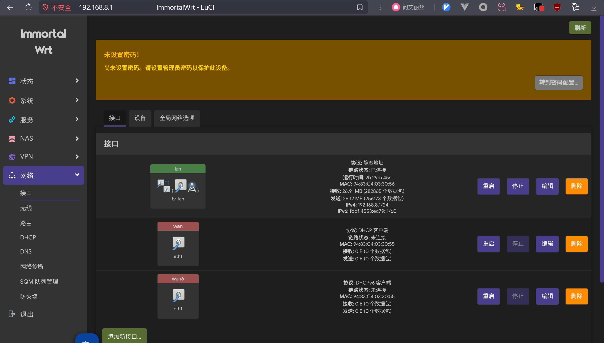

======================
ImmortalWrt 25.12.2 自用精简构建（GL-AR300M-NAND）
======================

`openwrt wiki howto build <https://openwrt.org/zh-cn/doc/howto/build>`_

基于 ImmortalWrt v25.12.2，精简常用插件，保留 USB 文件系统支持，LAN 192.168.8.1，包管理器 APK

设备列表
======================

===============  =============== ======================================================================================================================== ===============
型号              分支            构建状态                                                                                                                  推荐下载
===============  =============== ======================================================================================================================== ===============
ignet ar300m     main            .. image:: https://github.com/jcleng/gl-ar300m-ext-nand/workflows/Build%20OpenWrt/badge.svg
x86              x86             .. image:: https://github.com/jcleng/gl-ar300m-ext-nand/workflows/Build%20OpenWrt(x86)/badge.svg
jcg q30 pro      jcg_q30_pro     .. image:: https://github.com/jcleng/gl-ar300m-ext-nand/workflows/Build%20OpenWrt%20jcg_q30_pro/badge.svg
===============  =============== ======================================================================================================================== ===============

如何生成自己的.config配置文件
==============================

.. code-block:: shell

   # 使用 registry.cn-hangzhou.aliyuncs.com/jcleng/wrt-ubuntu:20.04 的docker镜像进行配置(下载feeds插件要一致),然后运行进行配置TUI界面(进入容器不要用root用户: docker exec -it -u $(id -u) wrt bash)

   # 保存之后用scripts/diffconfig.sh脚本进行导出刚刚配置的文件
   ./scripts/diffconfig.sh > min.config
   # 然后把min.config内容替换到本项目的.config文件即可(项目编译的时候make defconfig会重新补全的)

扩展软件包(插件)
==============================

.. code-block:: shell

   # 除了源自带的immortalwrt/packages外,可用手动添加其他的软件
   # kenzok8/openwrt-packages
   https://github.com/kenzok8/openwrt-packages

ar300m使用: 下载官方的uboot-img镜像(使用nand,nor不去动)
==============================

  `openwrt官方下载 <https://downloads.openwrt.org/releases/22.03.3/targets/ath79/nand/>`_

  `gl官方下载 <https://docs.gl-inet.com/en/3/release_notes/gl-ar300m/>`_

  `immortalwrt构建 <https://downloads.immortalwrt.org/releases/21.02.3/targets/ath79/nand/>`_

中继模式下如何保证上游离线仍能管理（wifi-mgmt-guard）
============================================================

问题: 单 radio 设备做中继会失联
--------------------------------

AR300M 只有一个 radio，做中继（客户端模式）时 AP 和 STA 只能共用同一个射频。
如果用 LuCI 的「中继模式」(relayd) 或 WDS，它会把 AP 接口**挂到 wwan 上**，
管理地址也由上游路由器的 DHCP 下发。上游一旦离线：

  - AP 其实还在广播，但没人下发 IP，客户端拿不到地址；
  - 上游网段不可达，LuCI 自然也打不开。

也就是「连得上 WiFi 却打不开 LuCI」= 直接失联。所以这个担心是成立的。

解决原则: 管理面与上游链路解耦
--------------------------------

把管理面（AP + LAN 静态地址 + DHCP）和上游链路彻底拆开，走三层路由而不是二层桥接：

  - AP 接口的 network **必须指向 lan**，绝不要指向 wwan；
  - lan 保持静态地址 192.168.8.1 和自己的 dnsmasq，不依赖上游；
  - 上游走 wan/wwan（proto=dhcp），防火墙默认放行 lan → wan；
  - 同射频 AP+STA 必须同信道，信道要固定，否则 STA 扫描会拖垮 AP。

这样上游断了只影响上网，管理面照常可用。

仓库内置兜底: wifi-mgmt-guard
--------------------------------

固件里已经带了兜底脚本，无需手工配置：

  - ``files/etc/init.d/wifi-mgmt-guard``：init 脚本，START=99 开机执行；
  - ``files/etc/uci-defaults/99-wifi-mgmt-guard``：首次启动确保 enable 并立即跑一次。

构建 workflow（``.github/workflows/build-openwrt.yml`` 的 ``Install files/ overlay (wifi-mgmt-guard)``
步骤）会在 ``make`` 之前把仓库的 ``files/`` 拷进 ``openwrt/files``，随 rootfs 一起打包。

每次开机幂等检查，**只补缺失项，不覆盖已有配置**：

  1. ``/etc/config/wireless`` 没有 wifi-device 时用 ``wifi config`` 生成；
  2. 确保所有 radio 的 disabled=0；
  3. 确保 lan 是静态地址（默认 192.168.8.1），原来 proto 非 static 就改成 static，并清掉 peerdns/reqdns；
  4. 确保 dhcp.lan 存在（interface=lan, start=100, limit=150, leasetime=12h）且没有 ignore=1；
  5. 确保存在 network=lan 的 AP 接口，没有就在第一个 radio 上补建：section 名 ``mgmt``
     （若该名已被非 AP 占用则改用 ``mgmt_ap``），SSID=AR300M-AP，encryption=psk2，key=12345678
     —— **密码请登录后自行修改**；
  6. 确保 uhttpd / dnsmasq 开机自启。

查看当前兜底状态：

.. code-block:: shell

   /etc/init.d/wifi-mgmt-guard status

会打印 radio、各 wifi-iface（区分「管理热点 OK」/「非管理面，上游离线会失联」/「STA」）
以及 lan 地址和「上游离线时可用地址」：

.. code-block:: shell

   == radio ==
     radio0: disabled=0 channel=36
   == wifi-iface ==
     mgmt: AP ssid=AR300M-AP network=lan  <- 管理热点 OK
     sta0: STA ssid=HomeWiFi network=wan
   == 管理面 ==
     lan: proto=static ip=192.168.8.1
     dhcp.lan: interface=lan ignore=
     上游离线时可用地址: http://192.168.8.1

上游离线时怎么办
----------------

  1. 用手机/电脑连 ``AR300M-AP`` 这个热点，或者用网线接 LAN 口；
  2. 浏览器访问 ``http://192.168.8.1`` 即可正常打开 LuCI 管理。

命令行基础使用,修改热点名称等：

.. code-block:: shell

   cat /etc/config/wireless
   # 修改对应默认的信道
   uci set wireless.default_radio0.ssid="300y"
   uci set wireless.default_radio0.encryption="psk2"
   uci set wireless.default_radio0.key="goodlifexxx"
   uci set wireless.mgmt.key="goodlifexxx"
   # 查看变更
   uci changes
   # 提交保存
   uci commit wireless
   # 重启网络生效
   /etc/init.d/network restart
   # 查看日志
   logread |grep wifi-mgmt-guard